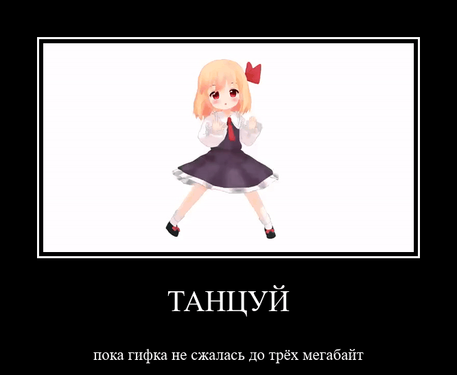
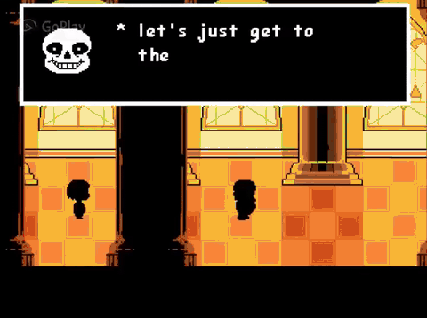

# GIF FACTORY
Утилита для быстрого превращения видео в `.gif`: сжатие до нужного размера, ускорение, обрезка, мемы и демотиваторы

**Пример работы:** Angry birds movie ужат до 8 мегабайт и ускорен в 40 раз

<p align="center">
  
</p>

___

# Зависимости

1. **Python 3.8+**
2. **FFmpeg** и **ffprobe** (должны быть прописаны в `PATH`)
3. (Опционально) **Pillow** — для точного переноса текста по реальной ширине шрифта. Без него ширина строк считается приблизительно

   ```bash
   pip install pillow
   ```

___

# Использование

```bash
python GIFEST.py [аргументы] [путь]
```

Путь лучше указывать в самом конце команды. Если путь не указан — обрабатываются все видео и гифки в текущей папке. Готовые гифки складываются в подпапку `GIFs` рядом с исходниками

Поддерживаемые форматы: `.mp4`, `.mkv`, `.avi`, `.mov`, `.webm`, `.webp`, `.gif`

## Аргументы

### Основные
| Аргумент | Описание |
|---|---|
| `path` | Путь к файлу или папке. По умолчанию — текущая папка |
| `-c`, `--compress` | Целевой размер в МБ. Скрипт перебирает пресеты от лучшего качества к худшему, пока гифка не влезет в лимит. `0` (по умолчанию) — без лимита. `auto` — подобрать лимит автоматически, см. [ниже](#авто-сжатие) |
| `-m`, `--mode` | Режим сжатия: `smooth` (по умолчанию), `default`, `emote` |
| `-u`, `--ultra` | Хардкорные пресеты (1–3 FPS) для очень длинных видео |
| `--speed` | Множитель скорости: `2` — в 2 раза быстрее, `0.5` — в 2 раза медленнее |
| `-ss`, `-to` | Обрезка: начало и конец, в секундах (`83`) или `ЧЧ:ММ:СС` (`00:01:23`) |
| `-o`, `--output` | Имя папки для готовых гифок (по умолчанию `GIFs`) |

**Режимы сжатия:**
- `smooth` — сохраняет плавность (до 30 FPS), жертвует палитрой и разрешением. Для геймплея и танцев
- `default` — сохраняет картинку (до 640px, дизеринг), жертвует FPS
- `emote` — крошечные пиксельные гифки 32–128px, как эмодзи

### Текст, мемы и демотиваторы
| Аргумент | Описание |
|---|---|
| `-ut`, `--upper-text` | Текст сверху (в демотиваторе — крупный заголовок) |
| `-bt`, `--bottom-text` | Текст снизу (в демотиваторе — мелкий подзаголовок) |
| `-tl`, `--text-layout` | Стиль: `pad` (по умолчанию) — расширить кадр полосами под текст, `overlay` — текст поверх видео, `demotivator` — классический демотиватор |
| `-bc`, `--bg-color` | Цвет полос для `pad` (по умолчанию `black`). Имя цвета или `#RRGGBB` |
| `-tc`, `--text-color` | Цвет текста. `auto` (по умолчанию) — чёрный или белый, смотря что контрастнее с фоном |
| `-f`, `--font` | Системное имя шрифта или путь к `.ttf`/`.otf`. По умолчанию `Impact`, в демотиваторе — `Times New Roman`. Если шрифт не найден — подставится запасной |

Длинный текст переносится автоматически, а принудительный перенос можно поставить через `\n`

### Дополнительные
| Аргумент | Описание |
|---|---|
| `-rv`, `--reverse` | Проиграть задом наперёд |
| `--nuke` | Эффект Deepfry (выжженные цвета, пересвет) |
| `--gpu` | NVENC (только NVIDIA) для быстрого пре-пасса тяжёлых видео |
| `-j`, `--jobs` | Количество файлов, обрабатываемых параллельно (по умолчанию — число ядер) |

## Авто-сжатие

`-c auto` сам выбирает лимит для каждого файла по длительности итоговой гифки (с учётом `-ss`/`-to` и `--speed`):

| Режим | Лимит |
|---|---|
| `smooth` | ~0.6 МБ за секунду |
| `default` | ~0.4 МБ за секунду |
| `--ultra` | ~0.15 МБ за секунду |
| `emote` | всегда 0.25 МБ |

Первые 30 секунд лимит растёт линейно, дальше — медленнее (как корень из длительности), чтобы длинные ролики не превращались в гифки на сотни мегабайт. Минимум — 1 МБ. Например, 5-секундный клип в `smooth` получит 3 МБ, минутный — ~25 МБ, 10-минутный — ~80 МБ

## Примеры
- `python GIFEST.py` — сконвертировать все видео в папке
- `python GIFEST.py -c auto "video.mp4"` — сжать до адекватного размера без подбора лимита вручную
- `python GIFEST.py -c 10 "Examples/Rumia dancing to her theme.mp4"` — сжать до 10 МБ (лимит Дискорда на гифки)
- `python GIFEST.py --speed 40 -c 10 -u "Angry_birds_movie.mkv"` — ускорить [Angry birds movie](#gif-factory) в 40 раз и уложить в 10 МБ
- `python GIFEST.py --speed 20 -c 10 "Family_guy.mp4"` — засунуть серию [Гриффинов](#family-guy) в 10 МБ
- `python GIFEST.py -ss "00:00:07" -to 187 --speed 4 "sonic_wave.mp4"` — обрезать [Sonic wave](#sonic-wave-4x) с 7 секунды до 3:07 и ускорить в 4 раза
- `python GIFEST.py -c 0.25 -m emote "cat_disco.mp4"` — мини-гифка-эмодзи

    
- `python GIFEST.py -ut "КОГДА КОД" -bt "НАКОНЕЦ ЗАРАБОТАЛ" "meme.mp4"` — классический мем с текстом сверху и снизу
- `python GIFEST.py -ut "ПРОСТО ТЕКСТ" -tl overlay "meme.mp4"` — текст поверх видео
- `python GIFEST.py -ss 3 -to 7 -c 3 -tl demotivator -ut "ТАНЦУЙ" -bt "пока гифка не сжалась до трёх мегабайт" "Examples/Rumia dancing to her theme.mp4"` — демотиватор

<p align="center">
    
</p>

___

# Гифки из [примеров](#примеры)

## [Sonic wave 4x](https://youtu.be/Dfm_LegCN9Q?si=Lfc9kxVBoY1U8vU7)

<p align="center">
  
</p>

## [Family guy](https://www.youtube.com/watch?v=mn-Tlb_wfjc)

<p align="center">
    
</p>

# Другие примеры

## -m emote
### Thanos
<p align="left">
    
    
    
    
    
    
    
    
    
    
    
    
</p>

### [Small Rumias dancing to her themes](https://www.youtube.com/watch?v=eK3L7E4k-VA)
`python GIFEST.py -c 2 -m emote "Rumia dancing to her theme.mp4"`

<p>
    
    
    
    
    
    
    
    
    
    
    
    
</p>

## [Undertale Sans bossfight](https://youtu.be/Vr4IYjeplJA?si=Sqn6e7KNvY-_2dPH)
<p align="center">
    
</p>

## [Rumia dancing to her theme](https://www.youtube.com/watch?v=eK3L7E4k-VA)

<p align="center">
    
</p>
